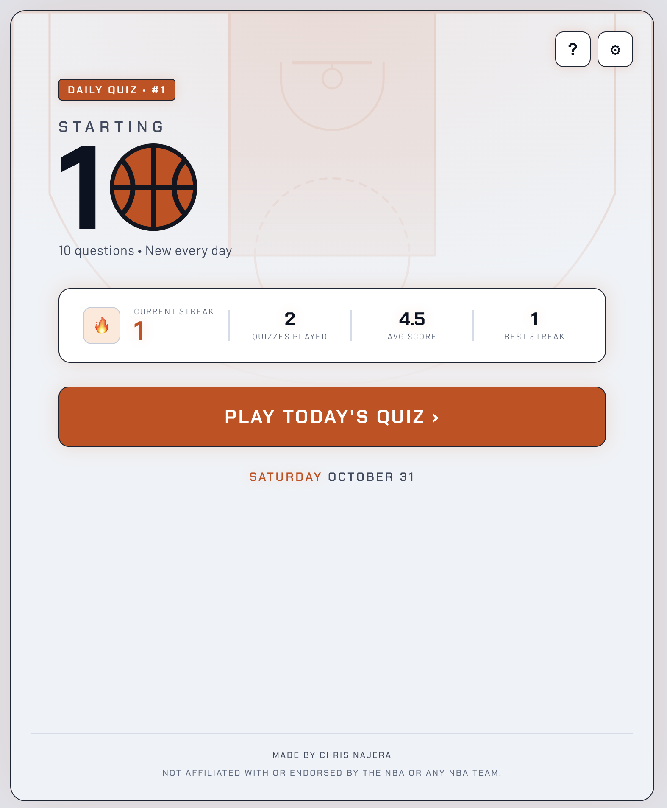

# Starting 10

**A new 10-question NBA trivia quiz every day.** Same questions for everyone, a streak to protect, and a shareable result grid.

**Play it:** [startingten.app](https://startingten.app)




## Features

- Daily quiz of 10 questions across four categories: contracts, standings, draft picks and stat leaders
- Instant feedback with the real numbers revealed after each answer
- Results page with a question-by-question breakdown, review mode and a next-quiz countdown
- Streak and stats tracking, saved in the browser (no account needed)
- Wordle-style shareable result
- Light and dark themes, responsive down to phone width

## How it works

1. **Generation.** A Node script pulls real NBA data from the [balldontlie API](https://www.balldontlie.io/) and builds questions from templates. It caches API responses, regenerates a question if it can't build a valid one, and skips questions that appeared recently.
2. **Review.** Generated questions are saved as `pending`. I review, edit, approve or reject them on a password-protected `/admin` page (Supabase Auth) before they go live.
3. **Serving.** Approved quizzes are stored by date. The frontend loads the quiz for the current Pacific-time day, so everyone gets the same one and it rolls over at midnight Pacific.

## Tech stack

- **Frontend:** React 18, Vite, React Router, CSS Modules
- **Backend:** Supabase (Postgres, Row Level Security, Auth)
- **Data pipeline:** Node.js scripts, balldontlie API
- **Hosting:** Vercel

## Run it locally

```bash
git clone https://github.com/cnajera-usd/nba-daily-quiz.git
cd nba-daily-quiz
npm install
cp .env.example .env   # then fill in the values
npm run dev
```

The frontend needs these in `.env`:

```
VITE_SUPABASE_URL=
VITE_SUPABASE_ANON_KEY=
```

The quiz generator (`scripts/dataGenerator`) additionally needs a Supabase service role key and a balldontlie API key. Those are server-side secrets and are never used by or exposed to the frontend.

Generate quizzes for the next few days:

```bash
node scripts/dataGenerator/runDailyQuiz.js 3
```

## Project structure

```
src/
  components/    shared UI (modals, header buttons, icons)
  hooks/         streak tracking
  pages/         Home, Quiz, Results, Admin
  utils/         date and quiz-number helpers
scripts/
  dataGenerator/ question generators, API fetching, saving to Supabase
```

## Roadmap

- [ ] Automated nightly quiz generation (GitHub Actions)
- [ ] Tie handling in stat-leader questions
- [ ] Past-quiz archive
- [ ] Accounts and global stats

## Disclaimer

Not affiliated with or endorsed by the NBA or any NBA team.

## Contact

Built by Chris Najera. For business inquiries: hello@startingten.app